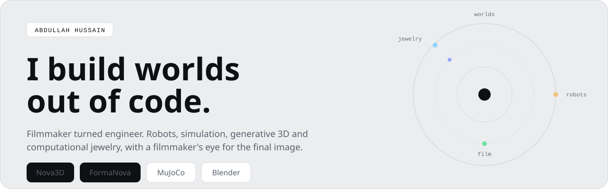
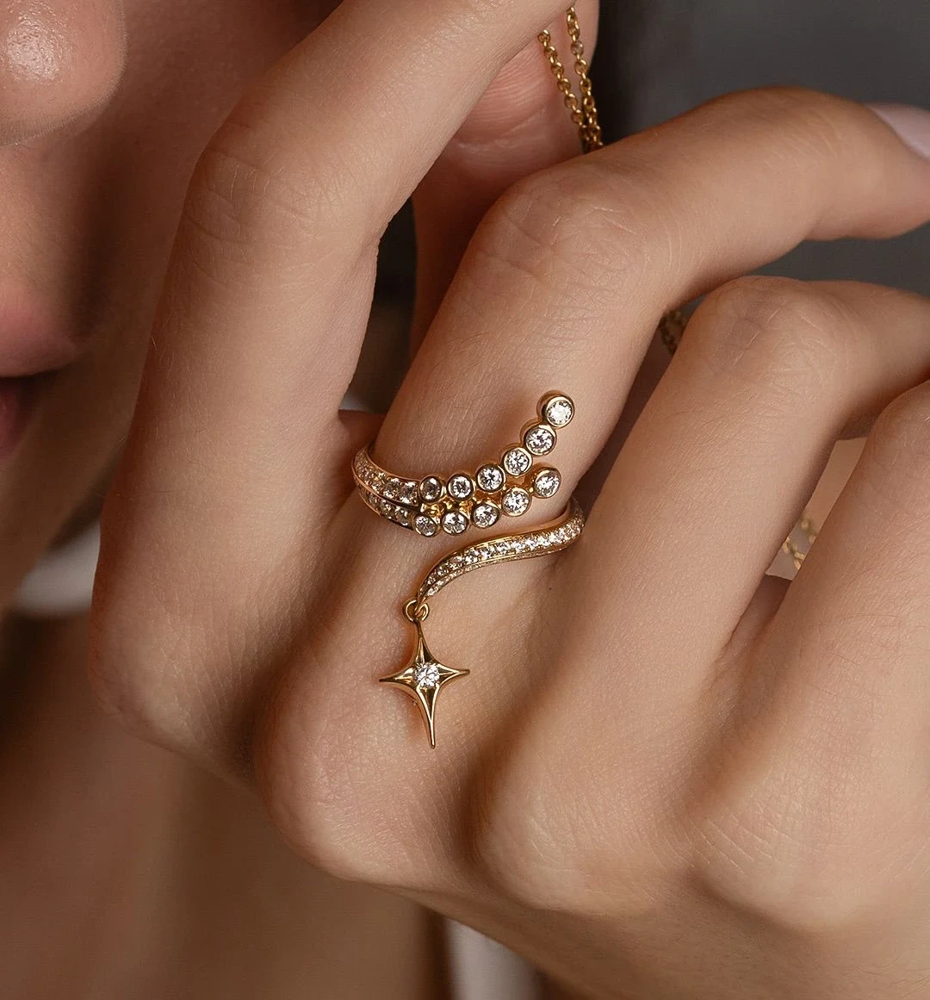
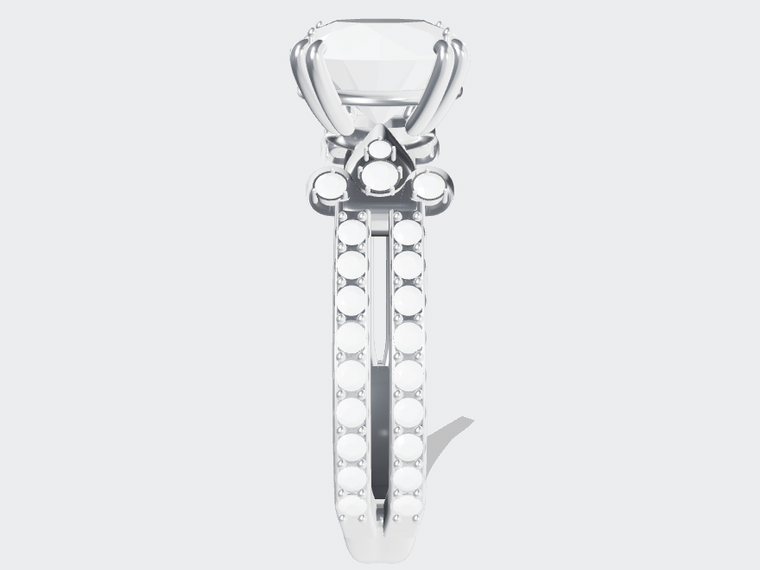

<a href="https://nova3d.xyz"> nova3d.xyz</a> · <a href="https://formanova.ai"> formanova.ai</a> · <a href="https://www.linkedin.com/in/abdullah-hanxie-338519252/"> linkedin</a> · <a href="https://www.instagram.com/abdullahanxie/"> instagram</a> · <a href="https://github.com/abdullahanxie?tab=repositories"> repositories</a>

 

I started with filmmaking. Editing and color grading taught me to notice rhythm, light, composition, and all the small choices that make an image feel right. Later I moved deeper into engineering and AI, but I never left that way of looking at things behind.

These days I build systems that write 3D worlds as code: environments robots can actually work in, jewelry with real manufacturing geometry, and the tools that make both feel effortless. I like projects where the technical problem and the visual problem are really the same problem.

 

<samp>building</samp>

## What I'm building.

| <a href="https://nova3d.xyz"><b>Nova3D</b></a> | <a href="https://formanova.ai"><b>FormaNova</b></a> |
|---|---|
| Worlds for robots, written as code. One prompt becomes a simulation-ready environment with working mechanisms, labeled masses and real contact physics, exported natively to MuJoCo, Isaac Sim, Gazebo and PyBullet. | Computational jewelry CAD on the same engine. Rings are authored as NURBS construction programs in millimetres: prong counts, stone sizes and band profiles you can measure back from the result. |

 

<samp>jewelry</samp>

## Computational jewelry.

One reference image in, one manufacturable CAD program out.

<table align="center">
  <tr>
    <td align="center" width="34%"> <b>Input</b> · the reference image</td>
    <td align="center" width="66%"> <b>Output</b> · a NURBS CAD program in millimetres: gold wrap band, twin pav&eacute; strands, graduated bezel-set diamonds, star charm. Every stone is a named part. Click to inspect in 3D.</td>
  </tr>
</table>

 

<samp>robots</samp>

## Robots at work in my worlds.

Scenes generated by Nova3D and simulated in MuJoCo, with real-life physics built in: gravity, contact, friction, mass and inertia.

<table align="center">
  <tr>
    <td align="center" width="50%"> <b>Café</b> · Unitree G1 waiters clear tables; a Go2 serves from its back on a learned walking policy</td>
    <td align="center" width="50%"> <b>Orbital lab</b> · at zero g a UR5e throws a sample across the module and a Franka Panda catches it in flight</td>
  </tr>
</table>

 

<samp>about</samp>

## A little more about the work.

<strong>AI and computer vision</strong>

I enjoy working close to the image itself. I have trained transformer-based vision models, worked on visual classification, built datasets, tracked experiments, and spent a lot of time understanding why a model gets something wrong. I also explore generative and multimodal AI, especially where it can give artists and designers more control instead of making their choices for them.

<strong>3D, simulation and design</strong>

I am interested in form, materials, light, and how an idea changes once it becomes spatial. My work moves between 3D design, physics simulation, rendering, engineering design, and the tools needed to make complex geometry understandable and useful.

<strong>Film and visual work</strong>

Filmmaking is still a big part of how I think. I have more than three years of experience across video production, editing, color grading, animation, and graphic design. Even when I am building software, I am usually thinking about the sequence, the feeling, and what the person on the other side will see.

<strong>Software and experiments</strong>

Python is usually where I begin, but I also build web interfaces, prototypes, automation, and small tools whenever an idea needs a shape. I prefer making a working version early, learning from it, and improving the parts that actually matter.

 

<samp>press</samp>

## Something people noticed.

In 2023 I used AI to reimagine Bollywood figures inside the visual world of *Barbie*. The images travelled much further than I expected and were featured by [The Times of India](https://timesofindia.indiatimes.com/life-style/spotlight/web-stories/ai-imagines-bollywood-celebs-in-the-barbie-world/photostory/101855715.cms), [IndiaTimes](https://www.indiatimes.com/ampstories/entertainment/virat-anushka-to-deepika-ranveer-ai-reimagines-popular-bollywood-celebrity-couples-in-barbie-world-609792.html), [MensXP](https://www.mensxp.com/ampstories/buzz-on-web/latest/139474-ai-imagines-bollywood-actors-in-the-barbie-film-latest-trending-alia-priyanka-margot-robbie.html) and [Onmanorama](https://www.onmanorama.com/entertainment/entertainment-news/2023/07/20/barbie-movie-bollywood-actors-ai-reimagination-priyanka-chopra-nick-jonas.html). That project reminded me that technical experiments can still carry culture, humor, and a point of view.

 

